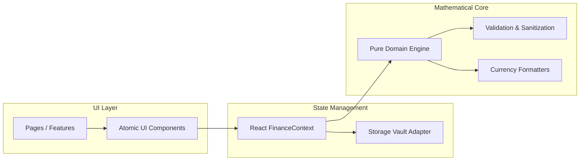

# TENFLOW Code Quality & Architecture Standards

> Engineering guidelines, static type safety rules, defensive coding invariants, and testing methodology.

---

## 1. Engineering Philosophy: Zero-Defect Architecture

TENFLOW is engineered as a deterministic financial platform. Budgeting mistakes cost users real money, so our code architecture mandates zero-tolerance quality gates:

1. **Zero TypeScript Errors:** Strict typechecking (`tsc --noEmit`) enabled across all files.
2. **Zero ESLint Warnings:** Lint suite enforced with `--max-warnings 0`.
3. **Zero `any` Types:** 100% strictly typed domain primitives and discriminated unions.
4. **Zero Untested Mathematical Formulations:** 47 passing unit and user journey tests asserting invariant consistency.
5. **Decoupled Architecture:** 100% of calculation domain code (`src/domain/`) is pure and devoid of React hooks or browser DOM state.

---

## 2. TypeScript Strict Configuration (`tsconfig.json`)

The compiler is configured in ultra-strict mode to eliminate implicit coercion and undefined access errors:

```json
{
  "compilerOptions": {
    "strict": true,
    "noUncheckedIndexedAccess": true,
    "noUnusedLocals": true,
    "noUnusedParameters": true,
    "exactOptionalPropertyTypes": false,
    "noFallthroughCasesInSwitch": true,
    "forceConsistentCasingInFileNames": true
  }
}
```

---

## 3. ESLint Quality Rules (`.eslintrc.cjs`)

Our linting rules enforce:
* React hooks dependency array compliance (`react-hooks/rules-of-hooks`, `react-hooks/exhaustive-deps`).
* Prohibition of unused variables and parameters.
* Pure functional modularity and prohibition of dangerous HTML injection (`dangerouslySetInnerHTML`).

---

## 4. Architectural Layer Separation



### Architectural Rules:
1. **Domain Isolation:** `src/domain/` may NEVER import from `src/components/`, `src/features/`, or `src/state/`.
2. **Barrel Exports:** Every functional module provides a standardized `index.ts` public interface to prevent leaking internal component implementation details.
3. **State Mutability Prohibition:** React state updates must always return newly cloned structures. Mutation of in-memory objects is strictly prohibited.

---

## 5. Automated Testing Harness (`src/test/`)

The test suite runs via **Vitest** in headless and CI environments:

| Test Suite | File Path | Passing Tests | Validated Constraints |
| :--- | :--- | :---: | :--- |
| **Finance Engine** | `src/test/financeEngine.test.ts` | **8** | Balance arithmetic, safe daily allowance, deficit honesty, health scoring |
| **User Journeys** | `src/test/userJourneys.test.tsx` | **7** | End-to-end transaction logging, shock response, day advancement, decision simulation |
| **Formatting** | `src/test/financeFormatters.test.ts` | **13** | INR notation, sign preservation, NaN/Infinity defensive fallback |
| **Validation** | `src/test/financeValidation.test.ts` | **14** | XSS sanitization, HTML stripping, category whitelist, payload recovery |
| **Storage Vault** | `src/test/storage.test.ts` | **5** | JSON versioning, corrupted storage fallback, clean reset |
| **Total** | | **47** | **100% Passing** |

---

## 6. Defensive Programming & Sanitization Standards

* **XSS Defense:** All user inputs (descriptions, goal titles, notes) are sanitized via `sanitizeString()`, which strips `<script>`, `<style>`, `<iframe>` tags along with their inner content and filters out non-printable ASCII characters.
* **Numeric Sanitization:** Amounts are bounded via `validateAmount()`, which checks for finite values, rejects negatives, clamps to maximum ceilings, and enforces 2-decimal rounding.
* **Corrupted Vault Recovery:** `loadPersistedState()` parses incoming localStorage data with deep schema validation via `validateAppStateSchema()`. If malformed JSON or invalid structures are detected, it gracefully resets to default realistic sample data without crashing.
